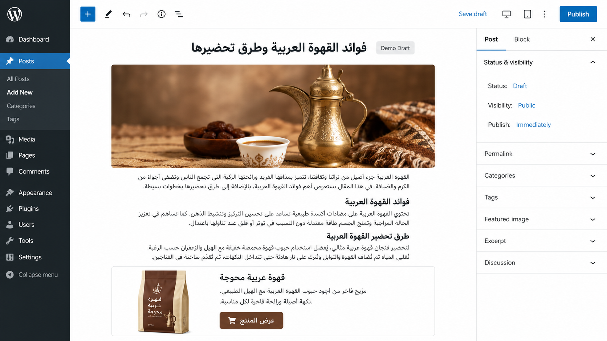
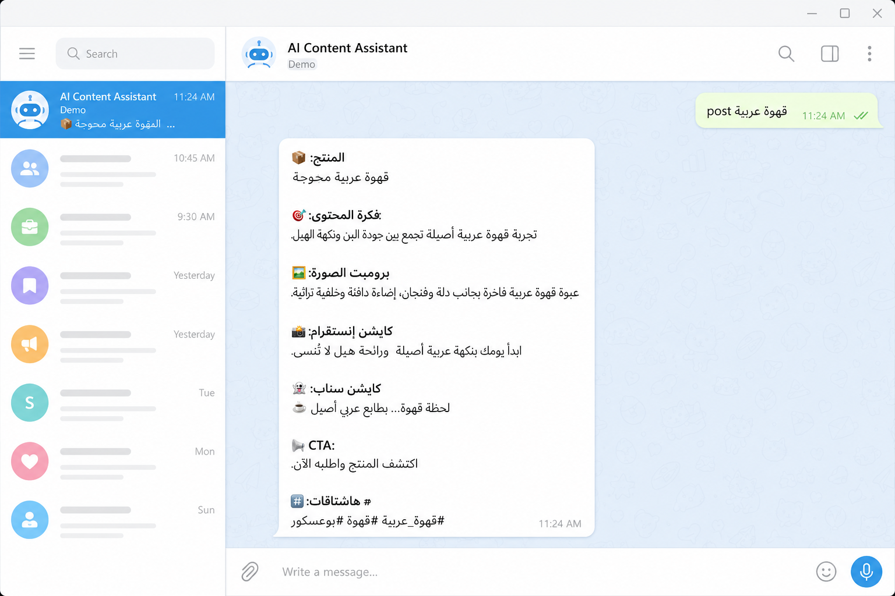
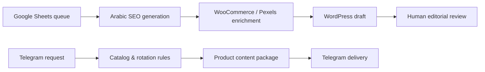
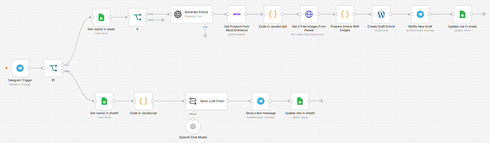

<p align="center"><strong>BADRELDIN — PRODUCTION AI PORTFOLIO</strong><br/><a href="https://github.com/Badrna3om">Profile</a> · <a href="https://github.com/Badrna3om/tactic-ai-media-platform">TACTIC / AMER</a> · <a href="https://github.com/Badrna3om/buaskoor-ai-commerce-platform">Commerce</a> · <a href="https://github.com/Badrna3om/ai-restaurant-operating-system">Restaurant</a> · <a href="https://github.com/Badrna3om/ai-content-automation-for-e-commerce">Marketing</a></p>

<div align="center">


### Two specialized n8n workflows: editorial SEO drafts and product social content

**Sanitized workflow demonstration with illustrated outputs.** Content is delivered for editorial review, not represented as unattended publishing or a live performance result.

[](https://github.com/Badrna3om/ai-content-automation-for-e-commerce/actions/workflows/validate-workflow.yml)

[**SEO workflow**](#workflow-1-seo-article-factory) · [**Product marketing workflow**](#workflow-2-product-marketing-generator) · [**Setup**](SETUP.md) · [**Portfolio**](https://github.com/Badrna3om)

</div>

## Two workflows. Two reviewable outputs.

<table>
<tr>
<td align="center" width="50%"><br/><b>01 · AI-assisted SEO article draft</b><br/><sub>Sheets queue → OpenAI → product & image enrichment → WordPress draft → editorial review</sub></td>
<td align="center" width="50%"><br/><b>02 · Structured product marketing package</b><br/><sub>Telegram trigger → product rotation → captions, CTA and hashtags → approval-ready delivery</sub></td>
</tr>
</table>

*Both screenshots are labeled illustrative demonstrations in the source repository, **not** proven production customer results.*

### Architecture and human oversight



**Engineering proof:** published sanitized n8n export, separate production paths, explicit queue/usage state and a GitHub Actions workflow validator.

---

## Portfolio quick view

**Arabic Content Operations · E-commerce**  
[WordPress draft preview](images/wordpress-draft-demo.png) · [Telegram output](images/telegram-content-output-demo.png)

**What this proves:** AI content pipeline design, content governance, CMS drafts and multi-channel publishing preparation.

> **Disclosure:** The repository is for public technical review. Operating credentials, private infrastructure, customer data and confidential business logic are excluded.

---

## Overview

This project automates two connected content-production workflows for e-commerce teams:

1. **SEO article production** — reads queued topics from Google Sheets, generates an Arabic article with OpenAI, enriches it with product data and royalty-free images, creates a WordPress draft, and notifies the team through Telegram.
2. **Product marketing content** — accepts a Telegram command, selects an active product, generates a content angle, image prompt, captions, call to action, and hashtags, then updates product usage history.

The repository contains a sanitized public workflow. API keys, credential IDs, spreadsheet IDs, chat IDs, webhook IDs, and private infrastructure identifiers have been replaced with placeholders.

## Business Problem

E-commerce teams often repeat the same manual cycle: select a product, research a topic, write content, find images, format an article, create a CMS draft, prepare social captions, and notify the team. This slows publishing and makes consistency difficult to maintain.

## Solution and Business Value

The workflow connects content planning, AI generation, product data, publishing, and team notifications in one controlled process.

- Reduces repetitive content-production steps
- Creates consistent Arabic content from structured product data
- Keeps WordPress publishing under human review by creating drafts
- Reuses product data across blog and social-media formats
- Balances product selection using usage history
- Allows manual product selection through Telegram
- Maintains operational status in Google Sheets
- Separates content generation from final approval and publishing

## Workflow Overview



The Telegram trigger routes requests into two branches: an SEO article pipeline and a product marketing content pipeline.

## Workflow 1: SEO Article Factory

```text
Google Sheets queue
        ↓
OpenAI article generation
        ↓
WooCommerce product lookup
        ↓
Pexels image search
        ↓
HTML preparation
        ↓
WordPress draft
        ↓
Telegram notification
        ↓
Queue status update
```

### Capabilities

- Processes rows marked as `queued`
- Generates 900–1,200-word Arabic SEO articles
- Produces clean HTML with headings and structured sections
- Retrieves a related WooCommerce product
- Finds landscape images through the Pexels API
- Inserts product and image context into the article
- Creates a WordPress post as `draft`
- Sends the editor a direct review notification
- Records the post ID and creation timestamp

### Example WordPress Draft


> Illustrative demo showing the expected draft structure. It does not display a production account or private data.

## Workflow 2: Product Marketing Generator

```text
Telegram command
        ↓
Product catalog lookup
        ↓
Manual or automatic selection
        ↓
OpenAI content generation
        ↓
Telegram content delivery
        ↓
Usage history update
```

### Capabilities

- Starts with a Telegram command such as `post` or `post Product Name`
- Filters the catalog to active products
- Supports exact and partial product-name matching
- Avoids repeatedly selecting the most recently used product
- Prioritizes products with lower usage counts
- Generates:
  - Content angle
  - AI image prompt
  - Instagram caption
  - Snapchat caption
  - Call to action
  - Hashtags
- Updates `last_used_at` and `times_used`

### Example Telegram Output


> Illustrative demo of the structured content response. No customer conversation or private account data is shown.

## Engineering Highlights

- Two content pipelines inside one n8n workflow
- Human review before WordPress publishing
- Structured product selection and rotation logic
- External API and SaaS integration
- Arabic-first prompts and output
- Persistent queue and usage state through Google Sheets
- Modular nodes for generation, enrichment, publishing, and notification
- Sanitized public export with replaceable configuration placeholders

## Technology Stack

- **Automation:** n8n
- **AI:** OpenAI GPT models
- **Content planning:** Google Sheets
- **Commerce:** WooCommerce
- **CMS:** WordPress
- **Images:** Pexels API
- **Operations:** Telegram Bot API
- **Logic:** JavaScript
- **Integration:** REST APIs, OAuth2, webhooks, and JSON

## Repository Structure

```text
ai-content-automation-for-e-commerce/
├── README.md
├── SECURITY.md
├── SETUP.md
└── workflows/
    └── ai-content-automation-public.json
```

## Quick Start

1. Import `workflows/ai-content-automation-public.json` into n8n.
2. Configure Google Sheets, OpenAI, WooCommerce, WordPress, and Telegram credentials.
3. Replace the Pexels placeholder with a secure n8n credential or environment-based value.
4. Replace spreadsheet, chat, domain, and webhook placeholders.
5. Review the expected spreadsheet columns in [SETUP.md](SETUP.md).
6. Test each branch with non-production data before activation.

## Security

Do not commit real credentials or production identifiers. The included workflow uses placeholders for all sensitive configuration. See [SECURITY.md](SECURITY.md) before importing or deploying it.

## Project Status

**Functional portfolio workflow / sanitized public version**

The original workflow was designed for a real e-commerce content operation. Production deployment should add stronger error handling, retry policies, execution monitoring, rate-limit controls, prompt/version tracking, and formal editorial approval rules.

## Author

**Badreldin Mohamed Awad**  
AI Automation Engineer · n8n Workflow Architect · Applied AI Systems Builder  
Al Ain, UAE  
[badrna3om@gmail.com](mailto:badrna3om@gmail.com)
